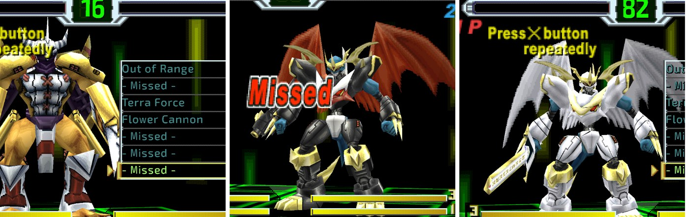
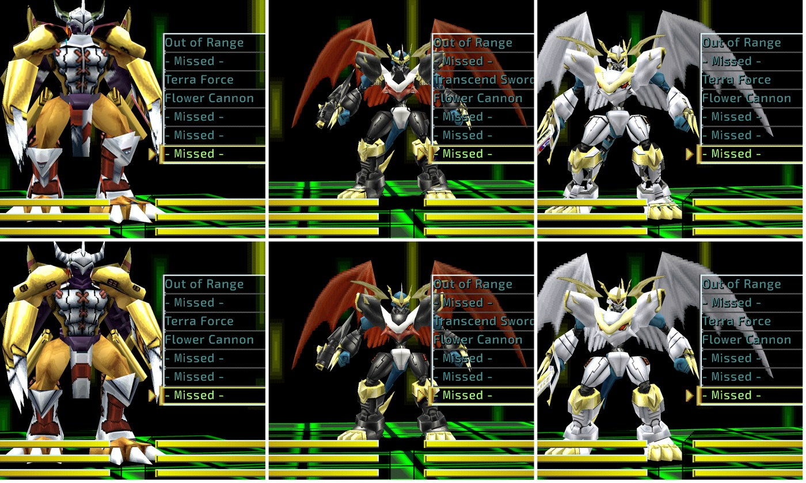
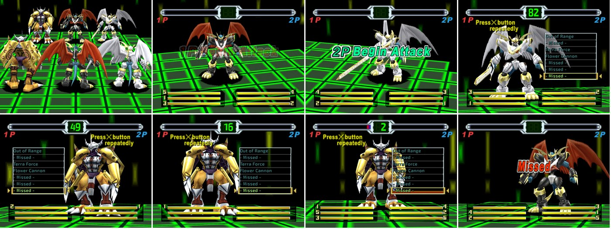

# DW2 Mod Studio 0.98

Digimon World 2 modden: Digimon, Techniken, Digitationslinien, Domains und Gegnergruppen bearbeiten, Digimon aus
Digimon World 3 in vorhandene Plätze importieren und alles als Mod für den DW2-PC-Port exportieren.
Spieldaten sind nicht enthalten: Du brauchst deine eigenen Abbilder von Digimon World 2 und 3.

*WarGreymon, Imperialdramon Fighter Mode und Imperialdramon Paladin Mode aus Digimon World 3 im Kampf des DW2-PC-Ports (Windows, GTX 1070, Vulkan, HD-Texturen).*

## Download (Windows 10/11, 64 Bit)

**[Version 0.98 herunterladen (Vorabversion)](https://github.com/emrah1818/dw2-dw3-viewer/releases/tag/v0.98)**

Neu: Animationseditor mit mehrteiligen Kampfaktionen, Namen aus DW3 und Namens-/ID-Suche.
Prüfstand und offene Spieltests: [TESTERGEBNISSE_0.98.md](TESTERGEBNISSE_0.98.md).

| Datei | Inhalt |
|---|---|
| [DW2_Mod_Studio_0.98_Windows_x64.zip](https://github.com/emrah1818/dw2-dw3-viewer/releases/download/v0.98/DW2_Mod_Studio_0.98_Windows_x64.zip) | Das Mod Studio (Viewer und Editor) |
| [DW2_PC_Port_API2_0.98_Windows_x64.zip](https://github.com/emrah1818/dw2-dw3-viewer/releases/download/v0.98/DW2_PC_Port_API2_0.98_Windows_x64.zip) | Der passende DW2-PC-Port (für Mods, HD-Texturen, größere Dateien) |
| [SHA256SUMS.txt](https://github.com/emrah1818/dw2-dw3-viewer/releases/download/v0.98/SHA256SUMS.txt) | Prüfsummen |

## Installation

1. Studio-ZIP vollständig entpacken und `DW2_3D_Viewer_Studio.exe` starten (nicht aus dem ZIP heraus).
2. Port-ZIP in einen eigenen Ordner entpacken und deine eigenen `dw2.pak` und `dw2.pak.slus` dazulegen.
3. Im Studio `dw2.pak` öffnen (Modus A, PC-Port), ändern, unter „Änderungen“ als Mod in den Port-Ordner exportieren.
4. `dw2.exe` im Port-Ordner starten.

Ausführlich: [ANLEITUNG.md](ANLEITUNG.md).

## Digimon aus Digimon World 3 importieren

1. `dw2.pak` öffnen und den DW2-Platz wählen, der ersetzt werden soll.
2. „DW3-Modelle“ öffnen, dein DW3-Abbild und ein Modell wählen.
3. „DW2-Slot mit DW3-Skelett und Bewegungen ersetzen“. Die Bewegungen sind aus den DW3-Kampfskripten vorbelegt und lassen sich ändern.
4. Vormerken, ansehen, als PC-Port-Mod exportieren.

Seit 0.95:
- Volle Geometrie, keine automatische Verkleinerung. Alle 248 Modelle des DW3-USA-Abbilds lassen sich ohne Dreiecksverlust umrechnen.
- HD-Textur mit den Originaltexeln von DW3 (automatische Größe, meist 512×1024, bis 2048×4096 möglich), im Port in 24 Bit.
- Augen blinzeln, auch mit HD-Textur, im Port und in der Studio-Vorschau.
- Karte „DW3-Import: Qualität (gemessen)“ vergleicht Original und Import; das DW3-Original lässt sich im Viewer ansehen.
- Die Größe im Kampf ist im Studio einstellbar.

Historischer Prüfstand **0.95** im Kampf auf Windows (GTX 1070, Vulkan): Greymon, Guilmon, Growlmon, MegaloGrowmon, WarGreymon,
Imperialdramon Fighter Mode, Imperialdramon Paladin Mode. Messwerte: [TESTERGEBNISSE_0.95.md](TESTERGEBNISSE_0.95.md).

### Bilder

**Vorher und nachher im selben Kampfbild** (oben 1.0.0-rc4, unten 0.95): In rc4 lagen Texturen auf falschen Körperteilen, weil
jede der 10 bis 16 Texturseiten in eine winzige Kachel verkleinert wurde.

**DW3-Original (links) und Import (rechts) im Studio**, gleiche Bewegung, gleicher Bildausschnitt. Das Original zeigt auch
Effektteile (Lichtkranz, Brustkanone), die DW3 im Spiel ausblendet.

**Kampftest auf Windows** (Battle Mode, automatischer Ablauf): WarGreymon und beide Imperialdramon-Formen.

Greymon, Guilmon, Growlmon (oben) und MegaloGrowmon mit WarGreymon und Imperialdramon Fighter Mode (unten).

Nicht übertragen werden DW3-Effekte, -Töne und -Kamerafahrten ([DW3_EFFEKTE_ANALYSE.md](DW3_EFFEKTE_ANALYSE.md)).

## Zwei Modi

- **Modus A, PC-Port (empfohlen):** `dw2.pak` öffnen. Mods, HD-Texturen, Digitationslevel, Kampfkameras, größere Dateien.
- **Modus B, PS1-Image:** DW2-Abbild öffnen, neues Abbild für Emulatoren exportieren. Größere DW3-Dateien werden im
  Abbild verlagert. HD-Texturen gibt es dort nicht.

## Dokumente

- Neu in dieser Version: [RELEASE_NOTES_0.98.md](RELEASE_NOTES_0.98.md), [CHANGELOG.md](CHANGELOG.md)
- Einschränkungen: [EINSCHRAENKUNGEN_0.95.md](EINSCHRAENKUNGEN_0.95.md), technische Grenzen: [GRENZEN_ANALYSE_0.95.md](GRENZEN_ANALYSE_0.95.md)
- Digitationslevel im Port: [DIGITATIONSLEVEL_SCHNITTSTELLE.md](DIGITATIONSLEVEL_SCHNITTSTELLE.md)

## Quellcode

Python 3.12 x64; `start_windows.bat` installiert `requirements.txt`. Für DW3 zuerst `python tools/build_dw3_converter.py`
(C++17-Compiler). `EXE_ERSTELLEN.bat` erzeugt das Studio-Paket. Der Port wird aus `emrah1818/dw2-pc-port` gebaut
(Commit in `integration/pc_port_base.txt`). Tests: `pytest`, Oberfläche `integration/uitest/`, Spiel `integration/ingame/`,
Windows `integration/windows/`. Es werden keine Originalspieldaten veröffentlicht.

Herkunft/Lizenzen: `SOURCES_v4_0.json`, `THIRD_PARTY_v4_0.md`, `licenses/`, `third_party/dw3_converter/UPSTREAM.json`.
