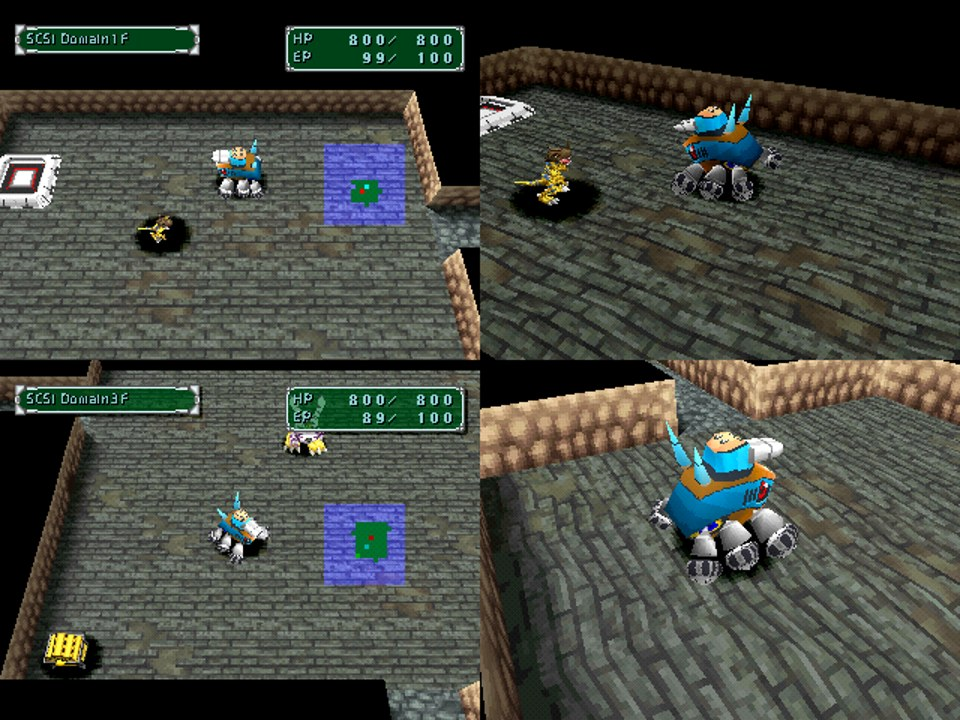
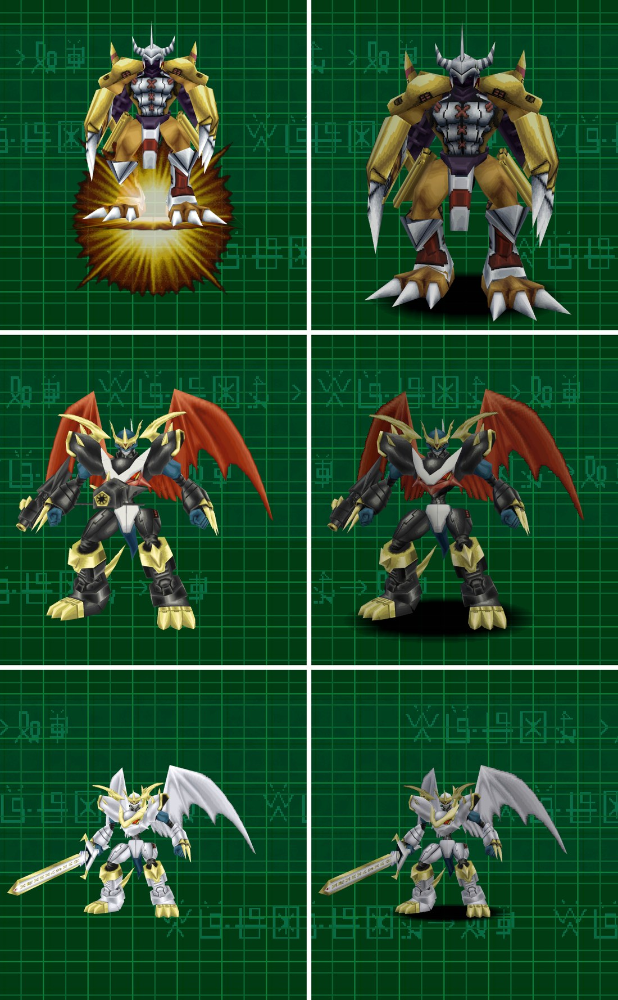
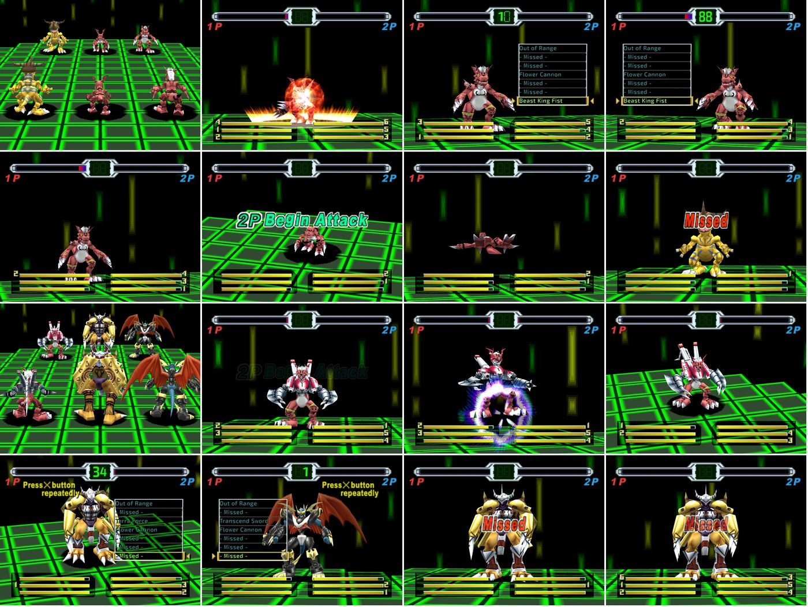

# DW2 Mod Studio 0.98.3

Digimon World 2 modden: Digimon, Techniken, Digitationslinien, Domains und Gegnergruppen bearbeiten, Digimon aus
Digimon World 3 in vorhandene Plätze importieren und alles als Mod für den DW2-PC-Port exportieren.
Spieldaten sind nicht enthalten: Du brauchst deine eigenen Abbilder von Digimon World 2 und 3.

*0.98.3 auf Windows (GTX 1070, Vulkan, HD-Texturen, Smooth Frames): MegaloGrowmon, WarGreymon, Imperialdramon
Fighter Mode, Growlmon mit Feuerangriff, Guilmon mit „Beast King Fist“ und MegaloGrowmons E-Stun Blast. Alle aus
Digimon World 3 importiert.*

## Download (Windows 10/11, 64 Bit)

**[Version 0.98.3 herunterladen](https://github.com/emrah1818/dw2-dw3-viewer/releases/tag/v0.98.3)**
(Vorabversion: noch keine 1.0, siehe „Noch offen“ unten)

| Datei | Inhalt |
|---|---|
| [DW2_Mod_Studio_0.98.3_Windows_x64.zip](https://github.com/emrah1818/dw2-dw3-viewer/releases/download/v0.98.3/DW2_Mod_Studio_0.98.3_Windows_x64.zip) | Das Mod Studio (Viewer und Editor) |
| [DW2_PC_Port_API2_0.98.3_Windows_x64.zip](https://github.com/emrah1818/dw2-dw3-viewer/releases/download/v0.98.3/DW2_PC_Port_API2_0.98.3_Windows_x64.zip) | Der passende DW2-PC-Port (für Mods, HD-Texturen, größere Dateien) |
| [SHA256SUMS.txt](https://github.com/emrah1818/dw2-dw3-viewer/releases/download/v0.98.3/SHA256SUMS.txt) | Prüfsummen |

## Neu seit 0.95

**Animationen**
- **Mehrteilige Kampfaktionen:** Jede Kampfanimation (Standby, Abwehr, Fallen, Liegen, Aufstehen, K.o., Attacke 1–3,
  Sieg) ist eine Kette aus DW3-Motions mit Start-/Endbild, Wiederholungen und Übergang.
  - Sie endet mit „halten“ oder „ab Bild X wiederholen“.
  - Die Vorgaben stammen direkt aus den DW3-Kampfskripten.
  - Gespeichert wird im normalen DW2-Format: Alte Mods bleiben gültig, der Port braucht dafür keine Änderung.
- **Übergänge ohne Sprünge:** DW3s Einblendung beginnt bei der Pose, die im Spiel davor wirklich zu sehen ist.
  Aufstehen und K.o. beginnen in der Liegepose.
- **Status je Animation:** „Durch Daten bestätigt“, „Automatisch erkannt“, „Manuell zugeordnet“, „Noch ungeklärt“.
  Unbekannte Motions werden nicht stillschweigend falsch zugeordnet. Fehlt eine Technik, bekommt nur ein Platz den
  Standardangriff.
- **Animationseditor:**
  - Zeitleiste mit sichtbarem Loop-Bereich, Bild für Bild vor und zurück.
  - Start, Ende und Loop direkt aus dem aktuellen Bild setzen; DW3-Originale ansehen.
  - Kampfabläufe simulieren (Attacke, Abwehr, Fallen und Aufstehen, K.o., Sieg).
- **Manuelle Auswahl (0.98.1/0.98.2):** Attacke 1–3 lassen sich unabhängig voneinander und beliebig oft ändern.
  Der ursprüngliche Loop-Beginn der DW3-Motion bleibt erhalten.

**DW3-Modelle mit Namen**
- **Namen aus dem Spiel:** Alle 248 Digimon-Modelle des DW3-USA-Abbilds tragen ihren Namen aus dem Spiel
  (DIGNAM-Text über die Kämpfertabelle).
  - Gleichnamige Varianten sind markiert, zum Beispiel BK WarGreymon als Partner und als Gegner.
  - Alternative Schreibweisen wie „Imperialdramon Fighter Mode“ sind als solche gekennzeichnet.
  - Hinweis: `M007AIRD` ist Airdramon; Birdramon gibt es in DW3 nicht.
- **Suche:** über Name, Teilname, Dateikürzel (z. B. `WGRE`) oder Modell-ID (z. B. `213`).
- **Vorschau:** Vorschaubild in der Liste; ein Klick zeigt das Modell im 3D-Viewer.

**Domain- und Feldmodelle ab #300 (0.98.3)**
- Lassen sich wieder öffnen, als Textur bearbeiten und durch DW3-Modelle ersetzen.
- Gemeinsam benutzte Animationsdateien werden richtig zugeordnet.
- Die Originalhöhe des Feldmodells ist der Größenmaßstab.

**Sonstiges**
- Ein unter Windows exportierter Mod mit HD-Texturen lässt sich jetzt auch auf anderen Systemen wieder ins Studio
  einlesen (Texturpfade mit `\`).
- Modelle, Texturen, HD und Licht sind wie in 0.95.

### Bilder 0.98.3

**Studio:** Ein DW3-Modell, nach Namen gesucht („WarGreymon“) und im 3D-Viewer geöffnet.

**Animationseditor:** Standby (links) und Attacke 1 als Kette aus sechs DW3-Motions mit Loop-Bereich (rechts).

**Eigener Spielstand, deutsche Version:** DW3-Guilmon als Gruppenmitglied „KADIR“ im Domain-Kampf. Gruppe von hinten
im Hauptmenü (links), Zielauswahl (rechts).

**Feldmodell:** DW3-Greymon als Gegner auf der Karte der SCSI Domain. Er steht im Standby auf dem Boden; die Begegnung
startet den Kampf.

### Geprüft und noch offen
- **Geprüft:**
  - 420 Tests mit echten Spieldaten.
  - Oberflächentests für Animationseditor und Namenssuche.
  - Windows mit GTX 1070: zwei vollständige Kämpfe mit sieben DW3-Digimon, ohne Fehler.
  - Eigener Spielstand mit eigenen Einstellungen (Deutsch, 16:9, Smooth Frames): zwei Kämpfe gewonnen.
  - Feldmodell im echten Spiel.
  - Details: [TESTERGEBNISSE_0.98.3.md](TESTERGEBNISSE_0.98.3.md) und
    [TESTERGEBNISSE_FORTSETZUNG_0.98.3.md](TESTERGEBNISSE_FORTSETZUNG_0.98.3.md).
- **Noch offen bis 1.0:**
  - K.o., Sieg, Fallen und Aufstehen im Bild.
  - Eigene Auswahl für Attacke 1–3 im Spiel.
  - PS1-Emulator.
  - Gehen der Feldmodelle.
  - Ein dünner Keil an einem älteren Guilmon-Import, der mit 0.98.3 nicht nachgestellt werden konnte:
    [UNTERSUCHUNG_KAMPFVIDEO_0.98.3.md](UNTERSUCHUNG_KAMPFVIDEO_0.98.3.md).
- **Grenzen:**
  - DW3-Effekte, Töne und Kamerafahrten werden nicht übertragen.
  - Fehlende Techniken oder Gehbewegungen bleiben offen und zeigen das Standby.
  - Meramons Flammen laufen etwa ein Drittel langsamer als in DW3.

## Installation

1. Studio-ZIP vollständig entpacken und `DW2_3D_Viewer_Studio.exe` starten (nicht aus dem ZIP heraus).
2. Port-ZIP in einen eigenen Ordner entpacken und deine eigenen `dw2.pak` und `dw2.pak.slus` dazulegen.
3. Im Studio `dw2.pak` öffnen (Modus A, PC-Port), ändern, unter „Änderungen“ als Mod in den Port-Ordner exportieren.
4. `dw2.exe` im Port-Ordner starten.

Ausführlich: [ANLEITUNG.md](ANLEITUNG.md).

## Digimon aus Digimon World 3 importieren

1. `dw2.pak` öffnen und den DW2-Platz wählen, der ersetzt werden soll.
2. „DW3-Modelle“ öffnen, dein DW3-Abbild und ein Modell wählen.
3. „DW2-Slot mit DW3-Skelett und Bewegungen ersetzen“. Die Bewegungen sind aus den DW3-Kampfskripten vorbelegt und lassen sich ändern.
4. Vormerken, ansehen, als PC-Port-Mod exportieren.

Seit 0.95:
- Volle Geometrie, keine automatische Verkleinerung. Alle 248 Modelle des DW3-USA-Abbilds lassen sich ohne Dreiecksverlust umrechnen.
- HD-Textur mit den Originaltexeln von DW3 (automatische Größe, meist 512×1024, bis 2048×4096 möglich), im Port in 24 Bit.
- Augen blinzeln, auch mit HD-Textur, im Port und in der Studio-Vorschau.
- Karte „DW3-Import: Qualität (gemessen)“ vergleicht Original und Import; das DW3-Original lässt sich im Viewer ansehen.
- Die Größe im Kampf ist im Studio einstellbar.

Historischer Prüfstand **0.95** im Kampf auf Windows (GTX 1070, Vulkan): Greymon, Guilmon, Growlmon, MegaloGrowmon, WarGreymon,
Imperialdramon Fighter Mode, Imperialdramon Paladin Mode. Messwerte: [TESTERGEBNISSE_0.95.md](TESTERGEBNISSE_0.95.md).

### Bilder (0.95)

**Vorher und nachher im selben Kampfbild** (oben 1.0.0-rc4, unten 0.95): In rc4 lagen Texturen auf falschen Körperteilen, weil
jede der 10 bis 16 Texturseiten in eine winzige Kachel verkleinert wurde.

**DW3-Original (links) und Import (rechts) im Studio**, gleiche Bewegung, gleicher Bildausschnitt. Das Original zeigt auch
Effektteile (Lichtkranz, Brustkanone), die DW3 im Spiel ausblendet.

**Kampftest auf Windows** (Battle Mode, automatischer Ablauf): WarGreymon und beide Imperialdramon-Formen.

Greymon, Guilmon, Growlmon (oben) und MegaloGrowmon mit WarGreymon und Imperialdramon Fighter Mode (unten).

Nicht übertragen werden DW3-Effekte, -Töne und -Kamerafahrten ([DW3_EFFEKTE_ANALYSE.md](DW3_EFFEKTE_ANALYSE.md)).

## Zwei Modi

- **Modus A, PC-Port (empfohlen):** `dw2.pak` öffnen. Mods, HD-Texturen, Digitationslevel, Kampfkameras, größere Dateien.
- **Modus B, PS1-Image:** DW2-Abbild öffnen, neues Abbild für Emulatoren exportieren. Größere DW3-Dateien werden im
  Abbild verlagert. HD-Texturen gibt es dort nicht.

## Dokumente

- Neu in dieser Version: [RELEASE_NOTES_0.98.3.md](RELEASE_NOTES_0.98.3.md), [CHANGELOG.md](CHANGELOG.md)
- Einschränkungen: [EINSCHRAENKUNGEN_0.95.md](EINSCHRAENKUNGEN_0.95.md), technische Grenzen: [GRENZEN_ANALYSE_0.95.md](GRENZEN_ANALYSE_0.95.md)
- Digitationslevel im Port: [DIGITATIONSLEVEL_SCHNITTSTELLE.md](DIGITATIONSLEVEL_SCHNITTSTELLE.md)

## Quellcode

Python 3.12 x64; `start_windows.bat` installiert `requirements.txt`. Für DW3 zuerst `python tools/build_dw3_converter.py`
(C++17-Compiler). `EXE_ERSTELLEN.bat` erzeugt das Studio-Paket. Der Port wird aus `emrah1818/dw2-pc-port` gebaut
(Commit in `integration/pc_port_base.txt`). Tests: `pytest`, Oberfläche `integration/uitest/`, Spiel `integration/ingame/`,
Windows `integration/windows/`. Es werden keine Originalspieldaten veröffentlicht.

Herkunft/Lizenzen: `SOURCES_v4_0.json`, `THIRD_PARTY_v4_0.md`, `licenses/`, `third_party/dw3_converter/UPSTREAM.json`.
