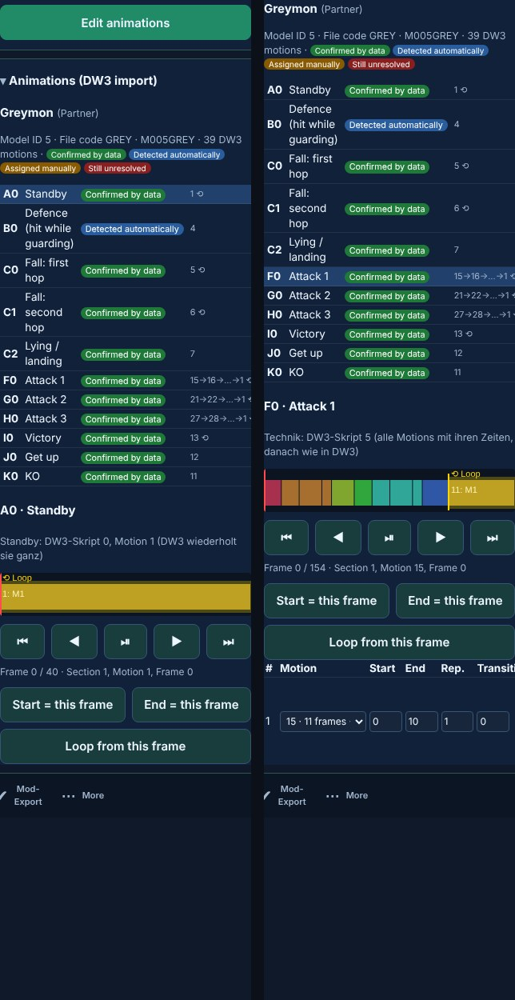
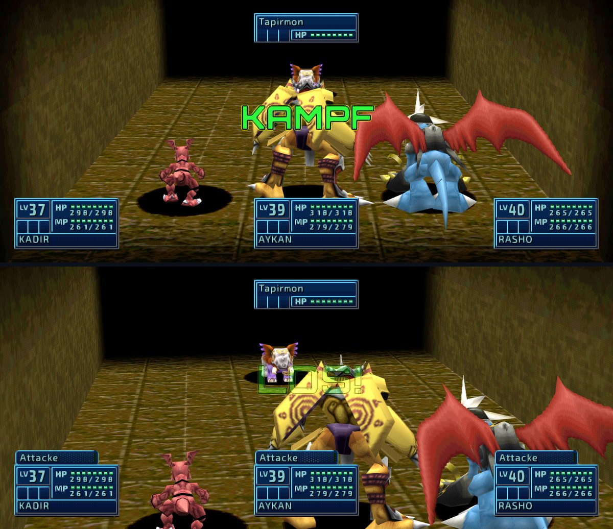

# DW2 Mod Studio

**English** · [Deutsch](#deutsch)

Mod Digimon World 2: edit Digimon, techniques, digivolution lines, domains and enemy groups, import Digimon from
Digimon World 3 into existing slots, and export everything as a mod for the DW2 PC port.
No game data is included: you need your own disc images of Digimon World 2 and 3.

*Windows (GTX 1070, Vulkan, HD textures, smooth frames): MegaloGrowmon, WarGreymon, Imperialdramon Fighter Mode,
Growlmon with a fire attack, Guilmon with “Beast King Fist” and MegaloGrowmon's E-Stun Blast. All imported from
Digimon World 3.*

## Download

**[Latest release: version 0.98.5](https://github.com/emrah1818/dw2-dw3-viewer/releases/tag/v0.98.5)** · [all releases](https://github.com/emrah1818/dw2-dw3-viewer/releases)
(pre-release series: not 1.0 yet, see “Still open” below)

You need three downloads:

1. **DW2 PC port:** [download it here](https://github.com/emrah1818/dw2-pc-port/releases/latest)
2. **Mod Studio:** from the table below
3. **PC port API:** from the table below. Unpack it into the PC port folder and replace the existing files.

| System | Mod Studio (viewer and editor) | PC port API (replaces files in the PC port) |
|---|---|---|
| Windows 10/11, 64-bit | [DW2_Mod_Studio_0.98.5_Windows_x64.zip](https://github.com/emrah1818/dw2-dw3-viewer/releases/download/v0.98.5/DW2_Mod_Studio_0.98.5_Windows_x64.zip) | [DW2_PC_Port_API2_0.98.5_Windows_x64.zip](https://github.com/emrah1818/dw2-dw3-viewer/releases/download/v0.98.5/DW2_PC_Port_API2_0.98.5_Windows_x64.zip) |
| Linux, 64-bit (x86_64) | [DW2_Mod_Studio_0.98.5_Linux_x64.tar.gz](https://github.com/emrah1818/dw2-dw3-viewer/releases/download/v0.98.5/DW2_Mod_Studio_0.98.5_Linux_x64.tar.gz) | [DW2_PC_Port_API2_0.98.5_Linux_x64.tar.gz](https://github.com/emrah1818/dw2-dw3-viewer/releases/download/v0.98.5/DW2_PC_Port_API2_0.98.5_Linux_x64.tar.gz) |

Checksums: [SHA256SUMS.txt](https://github.com/emrah1818/dw2-dw3-viewer/releases/download/v0.98.5/SHA256SUMS.txt).

## New in 0.98.4/0.98.5

- **Language follows your system.** On a German system the Studio starts in German, on every other system in English.
  You can still switch in the app; your choice is kept. The PC port already picks the menu language from the
  system on its first start.
- **English interface completed:** about 240 texts that were still German in English mode are translated
  (editors, hints, dialogs, menus).
- **Linux builds:** the Studio and the PC port are now also available for Linux x64.

## What it can do

- **DW3 import:** replace a DW2 slot with a DW3 model, skeleton and motions. Full geometry, HD texture from the DW3
  original texels, blinking eyes, adjustable battle size.
- **Animations:** each battle action (standby, guard, fall, lie, get up, KO, attack 1–3, victory) is a chain of DW3
  motions with start/end frame, repeats and blend. The animation editor shows a timeline with the loop range and
  simulates battle actions.
- **DW3 names:** all 248 Digimon models of the DW3 USA image carry their in-game name. Search by name, file code
  (e.g. `WGRE`) or model ID (e.g. `213`).
- **Editors:** Digimon values and names, techniques, digivolution lines and DP, domains and enemy groups, battle
  camera per Digimon, HD textures.
- **Two modes:** mode A, PC port (recommended): mods, HD textures, digivolve levels, battle cameras, larger files.
  Mode B, PS1 image: export a new image for emulators.

## Installation

1. Unpack the Studio package completely and start it: on Windows `DW2_3D_Viewer_Studio.exe` (not from inside the
   ZIP), on Linux `DW2_Mod_Studio.sh`.
2. Download the DW2 PC port here: [DW2 PC port releases](https://github.com/emrah1818/dw2-pc-port/releases/latest).
   Unpack it into its own folder and add your own `dw2.pak` and `dw2.pak.slus`.
3. Then unpack the API download from the table above (`DW2_PC_Port_API2_…`) into the same folder and replace the
   existing files when asked.
4. In the Studio open `dw2.pak` (mode A, PC port), make changes, and under “Changes” export them as a mod into the
   port folder.
5. Start `dw2.exe` (Windows) or `./dw2` (Linux) in the port folder.

Linux: the packages are built for x86_64 with glibc 2.35 or newer (Ubuntu 22.04, Debian 12, Fedora 36 and later).
If the 3D view stays black on an old graphics driver, start with `DW2_SOFTWARE_GL=1 ./DW2_Mod_Studio.sh`.

## Tested and still open

- **Tested:** 420 tests with real game data; UI tests for the animation editor and the name search; Windows with a
  GTX 1070 (two full battles with seven DW3 Digimon); own save file with own settings; field model in the real game.
  0.98.4/0.98.5: automatic language checked with German, English and French system settings; the Linux packages are built
  and smoke-tested automatically. Details: [TESTERGEBNISSE_0.98.5.md](TESTERGEBNISSE_0.98.5.md).
- **Still open for 1.0:** KO, victory, fall and get-up seen on screen; own choice of attack 1–3 in the game; PS1
  emulator; walking field models; the Linux packages on a real desktop by hand.
- **Limits:** DW3 effects, sounds and camera moves are not transferred. Missing techniques or walk motions stay open
  and show the standby.

## Source code

Python 3.12 x64; `start_windows.bat` installs `requirements.txt`. For DW3 first run `python tools/build_dw3_converter.py`
(C++17 compiler). `EXE_ERSTELLEN.bat` builds the Windows package; the release workflow builds Windows and Linux.
The port is built from `emrah1818/dw2-pc-port` (commit in `integration/pc_port_base.txt`). No original game data is
published. Origin/licences: `SOURCES_v4_0.json`, `THIRD_PARTY_v4_0.md`, `licenses/`.

---

## Deutsch

[English](#dw2-mod-studio-0985) · **Deutsch**

Digimon World 2 modden: Digimon, Techniken, Digitationslinien, Domains und Gegnergruppen bearbeiten, Digimon aus
Digimon World 3 in vorhandene Plätze importieren und alles als Mod für den DW2-PC-Port exportieren.
Spieldaten sind nicht enthalten: Du brauchst deine eigenen Abbilder von Digimon World 2 und 3.

### Download

**[Neueste Version: 0.98.5](https://github.com/emrah1818/dw2-dw3-viewer/releases/tag/v0.98.5)** · [alle Versionen](https://github.com/emrah1818/dw2-dw3-viewer/releases)
(Vorabversion: noch keine 1.0, siehe „Noch offen“ unten)

Du brauchst drei Downloads:

1. **DW2-PC-Port:** [hier herunterladen](https://github.com/emrah1818/dw2-pc-port/releases/latest)
2. **Mod Studio:** aus der Tabelle unten
3. **PC-Port-API:** aus der Tabelle unten. In den PC-Port-Ordner entpacken und die vorhandenen Dateien ersetzen.

| System | Mod Studio (Viewer und Editor) | PC-Port-API (ersetzt Dateien im PC-Port) |
|---|---|---|
| Windows 10/11, 64 Bit | [DW2_Mod_Studio_0.98.5_Windows_x64.zip](https://github.com/emrah1818/dw2-dw3-viewer/releases/download/v0.98.5/DW2_Mod_Studio_0.98.5_Windows_x64.zip) | [DW2_PC_Port_API2_0.98.5_Windows_x64.zip](https://github.com/emrah1818/dw2-dw3-viewer/releases/download/v0.98.5/DW2_PC_Port_API2_0.98.5_Windows_x64.zip) |
| Linux, 64 Bit (x86_64) | [DW2_Mod_Studio_0.98.5_Linux_x64.tar.gz](https://github.com/emrah1818/dw2-dw3-viewer/releases/download/v0.98.5/DW2_Mod_Studio_0.98.5_Linux_x64.tar.gz) | [DW2_PC_Port_API2_0.98.5_Linux_x64.tar.gz](https://github.com/emrah1818/dw2-dw3-viewer/releases/download/v0.98.5/DW2_PC_Port_API2_0.98.5_Linux_x64.tar.gz) |

Prüfsummen: [SHA256SUMS.txt](https://github.com/emrah1818/dw2-dw3-viewer/releases/download/v0.98.5/SHA256SUMS.txt).

### Neu in 0.98.4/0.98.5

- **Sprache folgt dem System.** Auf einem deutschen System startet das Studio auf Deutsch, auf allen anderen auf
  Englisch. Umstellen geht weiterhin in der App; die eigene Wahl bleibt gespeichert. Der PC-Port wählt die
  Menüsprache schon beim ersten Start nach dem System.
- **Englische Oberfläche vervollständigt:** rund 240 Texte, die im englischen Modus noch deutsch waren, sind übersetzt
  (Editoren, Hinweise, Dialoge, Menüs).
- **Linux-Versionen:** Studio und PC-Port gibt es jetzt auch für Linux x64. Gebaut für x86_64 mit glibc 2.35 oder
  neuer (Ubuntu 22.04, Debian 12, Fedora 36 und neuer). Bleibt die 3D-Ansicht bei einem alten Grafiktreiber schwarz:
  `DW2_SOFTWARE_GL=1 ./DW2_Mod_Studio.sh`.

### Neu seit 0.95

**Animationen**
- **Mehrteilige Kampfaktionen:** Jede Kampfanimation (Standby, Abwehr, Fallen, Liegen, Aufstehen, K.o., Attacke 1–3,
  Sieg) ist eine Kette aus DW3-Motions mit Start-/Endbild, Wiederholungen und Übergang.
  - Sie endet mit „halten“ oder „ab Bild X wiederholen“.
  - Die Vorgaben stammen direkt aus den DW3-Kampfskripten.
  - Gespeichert wird im normalen DW2-Format: Alte Mods bleiben gültig, der Port braucht dafür keine Änderung.
- **Übergänge ohne Sprünge:** DW3s Einblendung beginnt bei der Pose, die im Spiel davor wirklich zu sehen ist.
  Aufstehen und K.o. beginnen in der Liegepose.
- **Status je Animation:** „Durch Daten bestätigt“, „Automatisch erkannt“, „Manuell zugeordnet“, „Noch ungeklärt“.
  Unbekannte Motions werden nicht stillschweigend falsch zugeordnet. Fehlt eine Technik, bekommt nur ein Platz den
  Standardangriff.
- **Animationseditor:**
  - Zeitleiste mit sichtbarem Loop-Bereich, Bild für Bild vor und zurück.
  - Start, Ende und Loop direkt aus dem aktuellen Bild setzen; DW3-Originale ansehen.
  - Kampfabläufe simulieren (Attacke, Abwehr, Fallen und Aufstehen, K.o., Sieg).
- **Manuelle Auswahl (0.98.1/0.98.2):** Attacke 1–3 lassen sich unabhängig voneinander und beliebig oft ändern.
  Der ursprüngliche Loop-Beginn der DW3-Motion bleibt erhalten.

**DW3-Modelle mit Namen**
- **Namen aus dem Spiel:** Alle 248 Digimon-Modelle des DW3-USA-Abbilds tragen ihren Namen aus dem Spiel
  (DIGNAM-Text über die Kämpfertabelle).
  - Gleichnamige Varianten sind markiert, zum Beispiel BK WarGreymon als Partner und als Gegner.
  - Alternative Schreibweisen wie „Imperialdramon Fighter Mode“ sind als solche gekennzeichnet.
  - Hinweis: `M007AIRD` ist Airdramon; Birdramon gibt es in DW3 nicht.
- **Suche:** über Name, Teilname, Dateikürzel (z. B. `WGRE`) oder Modell-ID (z. B. `213`).
- **Vorschau:** Vorschaubild in der Liste; ein Klick zeigt das Modell im 3D-Viewer.

**Domain- und Feldmodelle ab #300 (0.98.3)**
- Lassen sich wieder öffnen, als Textur bearbeiten und durch DW3-Modelle ersetzen.
- Gemeinsam benutzte Animationsdateien werden richtig zugeordnet.
- Die Originalhöhe des Feldmodells ist der Größenmaßstab.

**Sonstiges**
- Ein unter Windows exportierter Mod mit HD-Texturen lässt sich jetzt auch auf anderen Systemen wieder ins Studio
  einlesen (Texturpfade mit `\`).
- Modelle, Texturen, HD und Licht sind wie in 0.95.

#### Bilder 0.98.3

**Studio:** Ein DW3-Modell, nach Namen gesucht („WarGreymon“) und im 3D-Viewer geöffnet.

**Animationseditor:** Standby (links) und Attacke 1 als Kette aus sechs DW3-Motions mit Loop-Bereich (rechts).

**Eigener Spielstand, deutsche Version:** DW3-Guilmon als Gruppenmitglied „KADIR“ im Domain-Kampf. Gruppe von hinten
im Hauptmenü (links), Zielauswahl (rechts).

**Feldmodell:** DW3-Greymon als Gegner auf der Karte der SCSI Domain. Er steht im Standby auf dem Boden; die Begegnung
startet den Kampf.

#### Geprüft und noch offen
- **Geprüft:**
  - 0.98.4/0.98.5: automatische Sprache mit deutscher, englischer und französischer Systemsprache geprüft; die
    Linux-Pakete werden automatisch gebaut und mit einem Starttest geprüft
    ([TESTERGEBNISSE_0.98.5.md](TESTERGEBNISSE_0.98.5.md)).
  - 420 Tests mit echten Spieldaten.
  - Oberflächentests für Animationseditor und Namenssuche.
  - Windows mit GTX 1070: zwei vollständige Kämpfe mit sieben DW3-Digimon, ohne Fehler.
  - Eigener Spielstand mit eigenen Einstellungen (Deutsch, 16:9, Smooth Frames): zwei Kämpfe gewonnen.
  - Feldmodell im echten Spiel.
  - Details: [TESTERGEBNISSE_0.98.3.md](TESTERGEBNISSE_0.98.3.md) und
    [TESTERGEBNISSE_FORTSETZUNG_0.98.3.md](TESTERGEBNISSE_FORTSETZUNG_0.98.3.md).
- **Noch offen bis 1.0:**
  - K.o., Sieg, Fallen und Aufstehen im Bild.
  - Eigene Auswahl für Attacke 1–3 im Spiel.
  - PS1-Emulator.
  - Gehen der Feldmodelle.
  - Linux-Pakete von Hand auf einem echten Desktop.
  - Ein dünner Keil an einem älteren Guilmon-Import, der mit 0.98.3 nicht nachgestellt werden konnte:
    [UNTERSUCHUNG_KAMPFVIDEO_0.98.3.md](UNTERSUCHUNG_KAMPFVIDEO_0.98.3.md).
- **Grenzen:**
  - DW3-Effekte, Töne und Kamerafahrten werden nicht übertragen.
  - Fehlende Techniken oder Gehbewegungen bleiben offen und zeigen das Standby.
  - Meramons Flammen laufen etwa ein Drittel langsamer als in DW3.

### Installation

1. Studio-Paket vollständig entpacken und starten: unter Windows `DW2_3D_Viewer_Studio.exe` (nicht aus dem ZIP heraus), unter Linux `DW2_Mod_Studio.sh`.
2. Den DW2-PC-Port bitte hier herunterladen: [DW2-PC-Port Releases](https://github.com/emrah1818/dw2-pc-port/releases/latest).
   In einen eigenen Ordner entpacken und deine eigenen `dw2.pak` und `dw2.pak.slus` dazulegen.
3. Danach den API-Download aus der Tabelle oben (`DW2_PC_Port_API2_…`) in denselben Ordner entpacken und die
   vorhandenen Dateien ersetzen, wenn gefragt wird.
4. Im Studio `dw2.pak` öffnen (Modus A, PC-Port), ändern, unter „Änderungen“ als Mod in den Port-Ordner exportieren.
5. Im Port-Ordner `dw2.exe` (Windows) oder `./dw2` (Linux) starten.

Ausführlich: [ANLEITUNG.md](ANLEITUNG.md).

### Digimon aus Digimon World 3 importieren

1. `dw2.pak` öffnen und den DW2-Platz wählen, der ersetzt werden soll.
2. „DW3-Modelle“ öffnen, dein DW3-Abbild und ein Modell wählen.
3. „DW2-Slot mit DW3-Skelett und Bewegungen ersetzen“. Die Bewegungen sind aus den DW3-Kampfskripten vorbelegt und lassen sich ändern.
4. Vormerken, ansehen, als PC-Port-Mod exportieren.

Seit 0.95:
- Volle Geometrie, keine automatische Verkleinerung. Alle 248 Modelle des DW3-USA-Abbilds lassen sich ohne Dreiecksverlust umrechnen.
- HD-Textur mit den Originaltexeln von DW3 (automatische Größe, meist 512×1024, bis 2048×4096 möglich), im Port in 24 Bit.
- Augen blinzeln, auch mit HD-Textur, im Port und in der Studio-Vorschau.
- Karte „DW3-Import: Qualität (gemessen)“ vergleicht Original und Import; das DW3-Original lässt sich im Viewer ansehen.
- Die Größe im Kampf ist im Studio einstellbar.

Historischer Prüfstand **0.95** im Kampf auf Windows (GTX 1070, Vulkan): Greymon, Guilmon, Growlmon, MegaloGrowmon, WarGreymon,
Imperialdramon Fighter Mode, Imperialdramon Paladin Mode. Messwerte: [TESTERGEBNISSE_0.95.md](TESTERGEBNISSE_0.95.md).

#### Bilder (0.95)

**Vorher und nachher im selben Kampfbild** (oben 1.0.0-rc4, unten 0.95): In rc4 lagen Texturen auf falschen Körperteilen, weil
jede der 10 bis 16 Texturseiten in eine winzige Kachel verkleinert wurde.

**DW3-Original (links) und Import (rechts) im Studio**, gleiche Bewegung, gleicher Bildausschnitt. Das Original zeigt auch
Effektteile (Lichtkranz, Brustkanone), die DW3 im Spiel ausblendet.

**Kampftest auf Windows** (Battle Mode, automatischer Ablauf): WarGreymon und beide Imperialdramon-Formen.

Greymon, Guilmon, Growlmon (oben) und MegaloGrowmon mit WarGreymon und Imperialdramon Fighter Mode (unten).

Nicht übertragen werden DW3-Effekte, -Töne und -Kamerafahrten ([DW3_EFFEKTE_ANALYSE.md](DW3_EFFEKTE_ANALYSE.md)).

### Zwei Modi

- **Modus A, PC-Port (empfohlen):** `dw2.pak` öffnen. Mods, HD-Texturen, Digitationslevel, Kampfkameras, größere Dateien.
- **Modus B, PS1-Image:** DW2-Abbild öffnen, neues Abbild für Emulatoren exportieren. Größere DW3-Dateien werden im
  Abbild verlagert. HD-Texturen gibt es dort nicht.

### Dokumente

- Neu in dieser Version: [RELEASE_NOTES_0.98.5.md](RELEASE_NOTES_0.98.5.md), [CHANGELOG.md](CHANGELOG.md)
- Einschränkungen: [EINSCHRAENKUNGEN_0.95.md](EINSCHRAENKUNGEN_0.95.md), technische Grenzen: [GRENZEN_ANALYSE_0.95.md](GRENZEN_ANALYSE_0.95.md)
- Digitationslevel im Port: [DIGITATIONSLEVEL_SCHNITTSTELLE.md](DIGITATIONSLEVEL_SCHNITTSTELLE.md)

### Quellcode

Python 3.12 x64; `start_windows.bat` installiert `requirements.txt`. Für DW3 zuerst `python tools/build_dw3_converter.py`
(C++17-Compiler). `EXE_ERSTELLEN.bat` erzeugt das Studio-Paket. Der Port wird aus `emrah1818/dw2-pc-port` gebaut
(Commit in `integration/pc_port_base.txt`). Tests: `pytest`, Oberfläche `integration/uitest/`, Spiel `integration/ingame/`,
Windows `integration/windows/`. Es werden keine Originalspieldaten veröffentlicht.

Herkunft/Lizenzen: `SOURCES_v4_0.json`, `THIRD_PARTY_v4_0.md`, `licenses/`, `third_party/dw3_converter/UPSTREAM.json`.
