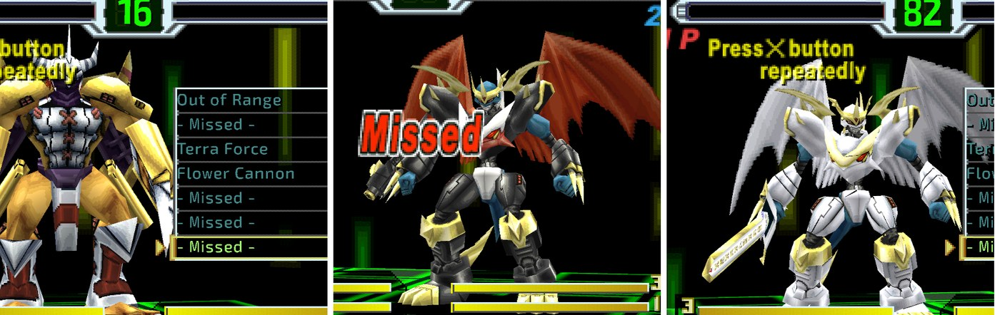
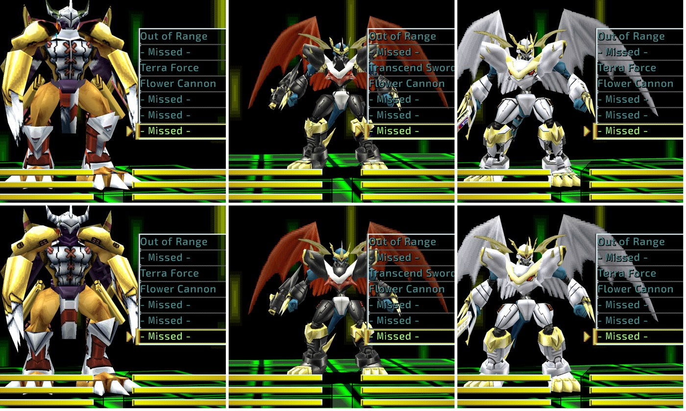
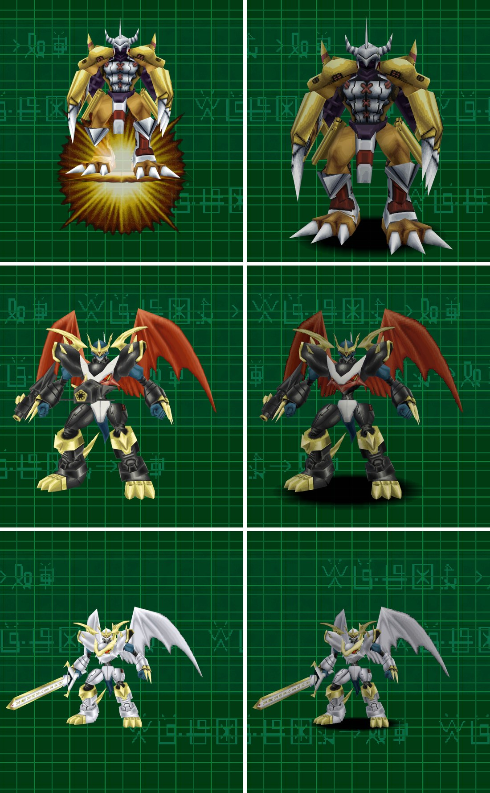

# DW2 Mod Studio 0.95

## Download
Unten unter **Assets**:
- `DW2_Mod_Studio_0.95_Windows_x64.zip`: das Mod Studio
- `DW2_PC_Port_API2_0.95_Windows_x64.zip`: der passende DW2-PC-Port

Beide ZIPs entpacken. Zum Port die eigenen `dw2.pak` und `dw2.pak.slus` legen. Spieldaten sind nicht enthalten.

Zwischenrelease (kein 1.0 FINAL). Schwerpunkt: Digimon aus Digimon World 3 in voller Qualität in den DW2-PC-Port bringen.

## Neu gegenüber 1.0.0-rc4
- **Texturen:** neuer Atlas aus den genutzten UV-Bereichen, HD-Textur mit den Originaltexeln an den Stellen, die das
  Spiel liest. Behebt die falschen Farben bei WarGreymon, Imperialdramon Fighter Mode und Paladin Mode und die hellen
  Kantenlinien.
- **Keine automatische Verkleinerung:** volle Geometrie und alle Bewegungsbilder, auch im PS1-Image (größere Dateien
  werden im Image verlagert). Verkleinern nur mit ausdrücklicher Zustimmung, sonst Fehlermeldung mit Grund.
- **PC-Port:** HD-Texturen in 24 Bit (GPU-Renderer), bis 2048×4096 in voller Größe, Texturspeicher bis 7 × 128 MiB
  nach Bedarf, Blinzeln mit HD, alles im Log nachvollziehbar.
- **Studio:** Qualitätskarte (Original gegen Import, gemessen), DW3-Original im Viewer, HD-Vorschau automatisch und
  mit Blinzeln, Pixel-Look nur als Filter, Größenfaktor korrigiert.
- Alle 248 DW3-Modelle lassen sich ohne Dreiecksverlust umrechnen.

## Getestet
Sieben Digimon im Kampf auf Windows (GTX 1070, Vulkan): Greymon, Guilmon, Growlmon, MegaloGrowmon, WarGreymon,
Imperialdramon Fighter Mode, Imperialdramon Paladin Mode. Details und Messwerte: `TESTERGEBNISSE_0.95.md`.

## Installation
Siehe `ANLEITUNG.md`. Kurz: Studio-ZIP entpacken und `DW2_3D_Viewer_Studio.exe` starten. Port-ZIP in einen eigenen
Ordner entpacken, eigene `dw2.pak` und `dw2.pak.slus` dazulegen. Spieldaten sind nicht enthalten.

## Einschränkungen
`EINSCHRAENKUNGEN_0.95.md`, `GRENZEN_ANALYSE_0.95.md`.

## Bilder
Vorher (1.0.0-rc4, oben) und nachher (0.95, unten) im selben Kampfbild:

DW3-Original (links) und Import (rechts) im Studio:

