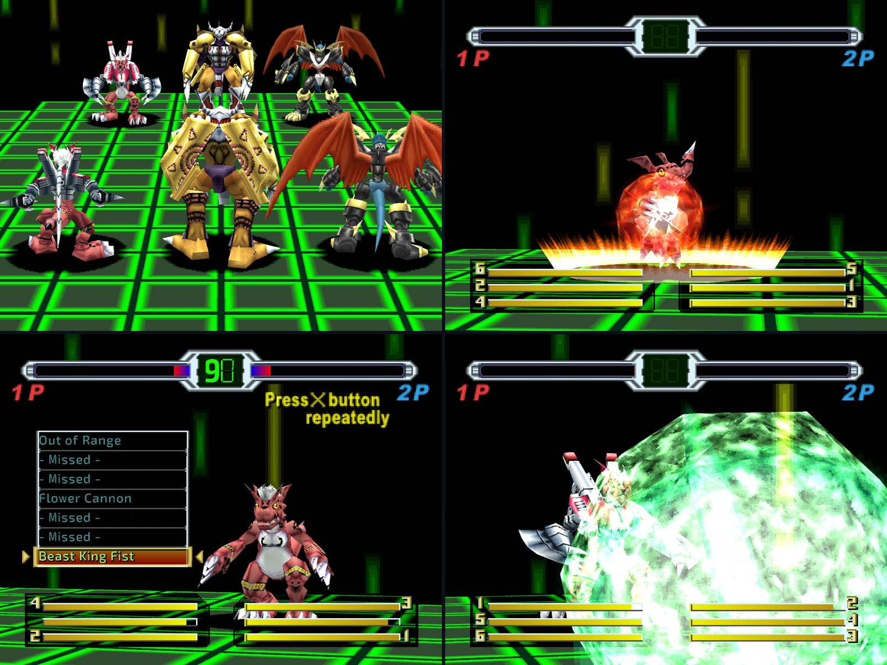
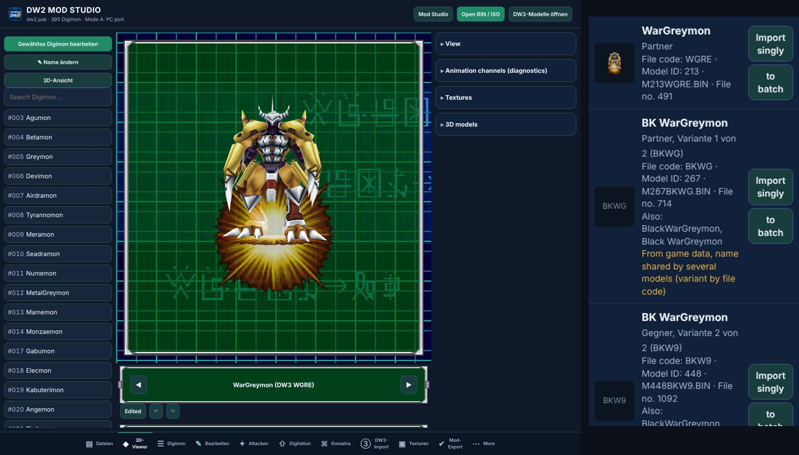
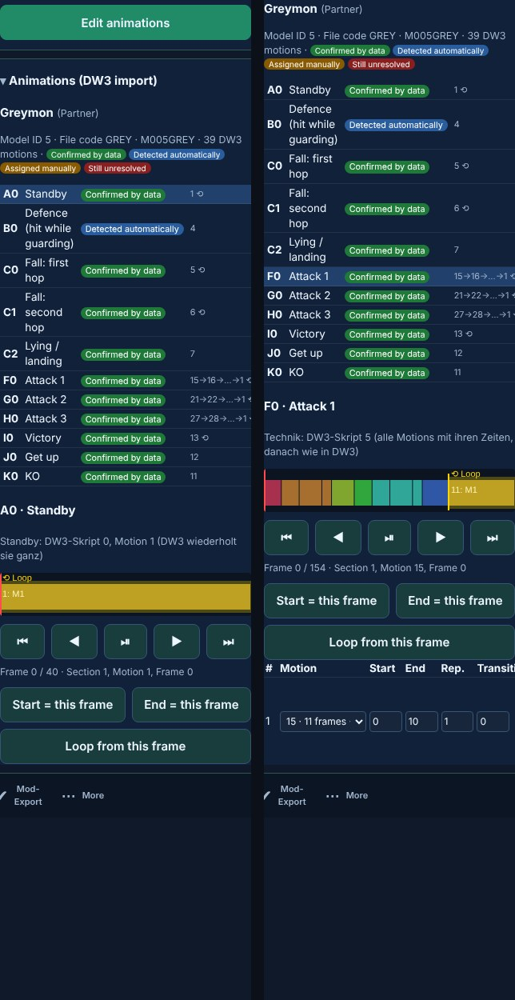
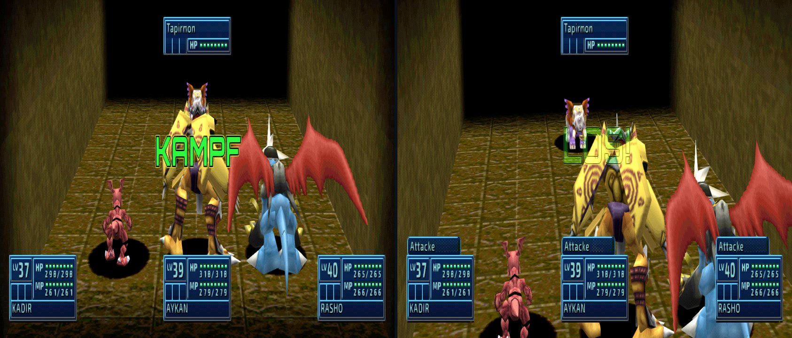
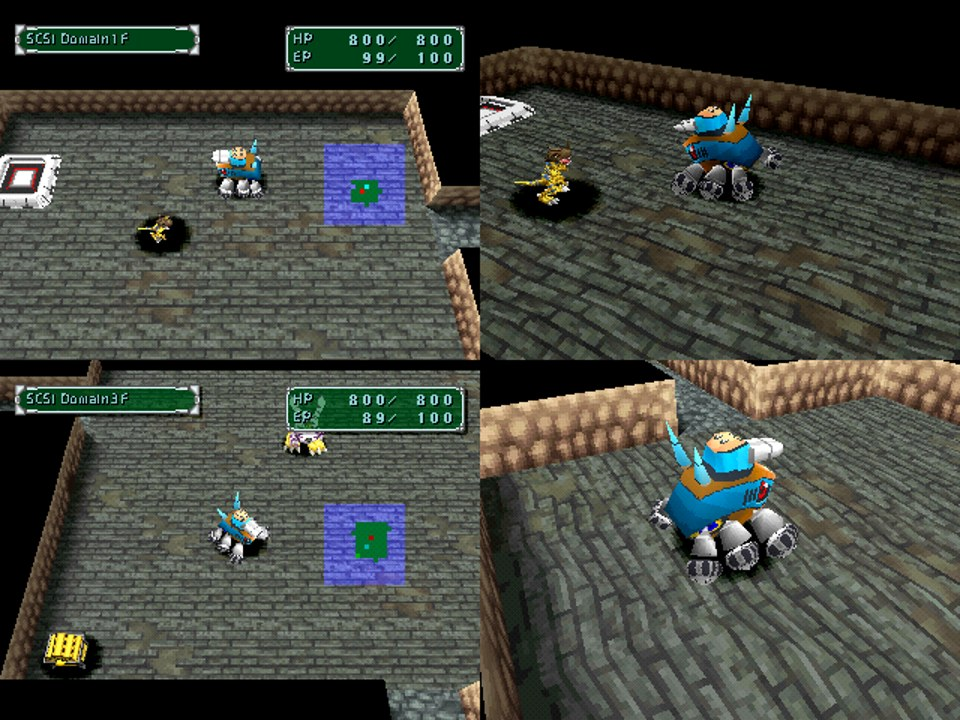

# DW2 Mod Studio 0.98.3

## Download
Unten unter **Assets**:
- `DW2_Mod_Studio_0.98.3_Windows_x64.zip`: das Mod Studio
- `DW2_PC_Port_API2_0.98.3_Windows_x64.zip`: der passende DW2-PC-Port

Beide ZIPs entpacken. Zum Port die eigenen `dw2.pak` und `dw2.pak.slus` legen. Spieldaten sind nicht enthalten.
Vorabversion: noch keine 1.0.

## Neu seit 0.95
- **Animationssystem:** Kampfaktionen aus mehreren DW3-Motions (Start/Ende, Wiederholung, Übergang, Loop ab
  beliebigem Bild), vorbelegt aus den DW3-Kampfskripten, mit Status je Animation.
- **Animationseditor:** Zeitleiste, Loop-Bereich, Bild für Bild, Kampfsimulation.
- **DW3-Namen aus dem Spiel:** für alle 248 Modelle, mit Suche über Name, Kürzel und Modell-ID, Vorschaubild,
  Klick öffnet den Viewer.
- **0.98.1/0.98.2:** Eigene Auswahl für Attacke 1–3 wirkt zuverlässig; der DW3-Loop-Beginn bleibt erhalten.
- **0.98.3:** Domain- und Feldmodelle ab #300 lassen sich öffnen, bearbeiten und durch DW3-Modelle ersetzen
  (Details unten).

## Im Spiel geprüft (nach der Veröffentlichung, 15.11.2026)
- **Windows mit GTX 1070, Port 0.98.3, Vulkan, Smooth Frames:**
  - Zwei vollständige Kämpfe mit Greymon, Guilmon, Growlmon, MegaloGrowmon, WarGreymon und Imperialdramon FM.
  - Kein Fehler im Log; Angriffe und Effekte im Bild.
- **Eigener Spielstand, deutsche Version, eigene Einstellungen:** DW3-Guilmon als Gruppenmitglied, zwei
  Domain-Kämpfe gewonnen.
- **Feldmodell:** DW3-Greymon als Gegner auf der Domain-Karte, Begegnung und Kampf.

Noch offen bis 1.0:
- K.o., Sieg, Fallen und Aufstehen im Bild.
- Eigene Auswahl für Attacke 1–3 im Spiel.
- PS1-Emulator.
- Gehen der Feldmodelle.
- Der Keil aus dem Kampfvideo: mit 0.98.3 nicht nachgestellt, die Ursache ist nicht bestimmt.

Einzelheiten im Repository: `TESTERGEBNISSE_FORTSETZUNG_0.98.3.md`.

---

## Korrektur 0.98.3: Domain-Modelle ab #300

Autor: Codex, 15. November 2026. Korrektur auf Basis von 0.98.2, als Vorabversion.

## Behoben

Beim Öffnen von Modellen wie #304 QTNK und #305 QYNM erschien
`[Errno 17] File exists … D304QTNK.BIN`. Diese Modelle verwenden eine physische E-Datei
für mehrere logische Animationsplätze (A/D/E). Bisher ging diese Mehrfachzuordnung verloren,
und das Studio versuchte, denselben Zielnamen mehrfach anzulegen.

- Vorschau für die Domain-/Feld-/NPC-Modelle ab #300 wiederhergestellt.
- Physische Dateien werden nur einmal gelesen, die zugeordneten Slots bleiben erhalten.
- Texturen können wieder exportiert, bearbeitet und übernommen werden.
- DW3-Ersetzung bearbeitet die vorhandenen physischen Clips einmal statt mehrfach über
  verschiedene Slotnamen. Bei den Domain-Modellen erscheinen E0 (Standby) und E1 (Gehen).
- Standby ist vorbelegt. Eine DW3-Gehbewegung wird nicht geraten: weitere Bewegungen bleiben
  ausdrücklich als noch ungeklärt markiert und lassen sich mit der Motion-Auswahl belegen.
- Größenfaktor 1 behält die Originalhöhe des Feldmodells; keine Kampfkamera wird verändert.
- Der Animationseditor zeigt Feldrollen sowie Standby-/Gehen-Simulationen.
- Scheitert ein Ladevorgang, bleibt nicht mehr das vorherige Modell unter dem neuen Namen stehen.
- Neuer Vorschau-Cache v10; alte Vorschauen werden dafür nicht wiederverwendet.

## Download / Anwenden

`DW2_Mod_Studio_0.98.3_Windows_x64.zip` vollständig entpacken, Studio starten,
`dw2.pak` öffnen und das gewünschte Modell ab #300 auswählen.
Zum Ersetzen DW3-Modell öffnen, den Feldplatz wählen, die vorhandenen Clips zuordnen,
vormerken und als Mod exportieren. Der vorhandene kompatible Begleit-Port aus 0.98.x
kann weiterverwendet werden; die Engine wurde nicht geändert.

## Prüfstand

Mit der bereitgestellten Original-PAK: **192/192 Modelle ab #300 ohne Konvertierungsfehler**.
Echte DW3-Ersetzungen von #300, #304, #305, #350 und #400 einschließlich Vorschau,
Projekt speichern/neu öffnen und Mod-Export bestanden. PNG-Export, Texturänderung,
Übernahme und Vorschau an #304 bestanden. Die Original-PAK blieb unverändert.

Automatische Regression, UI-/Windows-Build- und Startprüfung: `TESTERGEBNISSE_0.98.3.md`
sowie die dem Release beiliegenden Protokolle. **Kein neuer Lauf dieser Ersetzungen in einer
bespielten Domain oder auf dem Nutzer-PC.** Die allgemeine Grafikglitch-Meldung aus dem
vorherigen Kampfvideo ist mit dieser Korrektur nicht als behoben behauptet.
Spieldaten sind nicht in den Downloads enthalten.
