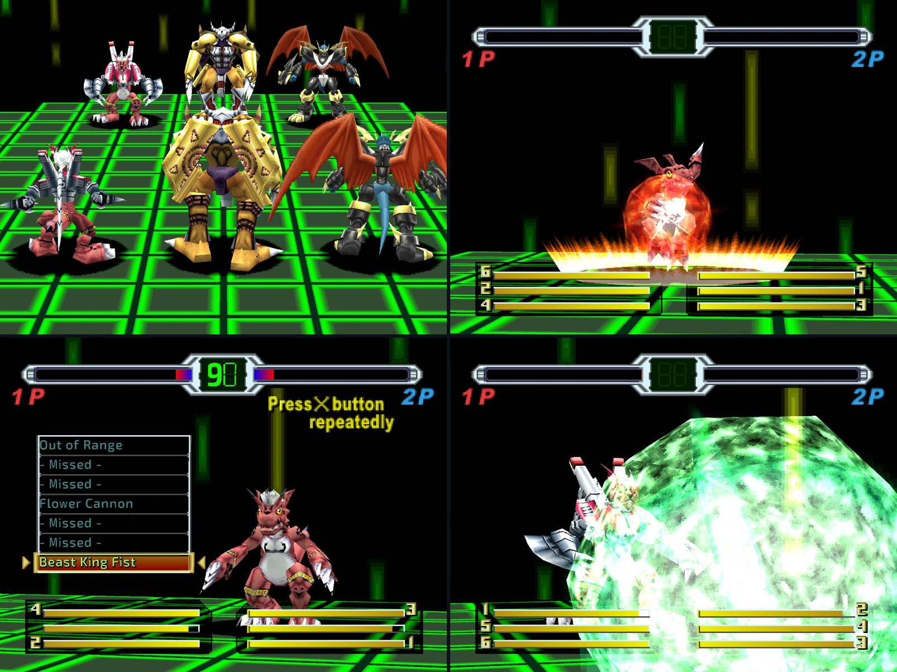

# DW2 Mod Studio 0.98.4

**English** (Deutsch below)

## Downloads (Assets below)

| System | Mod Studio | Matching DW2 PC port |
|---|---|---|
| Windows 10/11, 64-bit | `DW2_Mod_Studio_0.98.4_Windows_x64.zip` | `DW2_PC_Port_API2_0.98.4_Windows_x64.zip` |
| Linux x64 (glibc 2.35+) | `DW2_Mod_Studio_0.98.4_Linux_x64.tar.gz` | `DW2_PC_Port_API2_0.98.4_Linux_x64.tar.gz` |

Unpack both packages. Put your own `dw2.pak` and `dw2.pak.slus` next to the port. No game data is included.
Pre-release series: not 1.0 yet.

## New
- **Automatic language:** the Studio starts in German on a German system and in English on every other system.
  Switching in the app still works and is remembered. Menus and file dialogs of the desktop window follow too.
- **English interface completed:** about 240 texts that were still German in English mode are translated.
- **Linux:** Studio and PC port as Linux x64 packages (start `DW2_Mod_Studio.sh` or `./dw2`).
- Everything from 0.98.3 (animation system, DW3 names, field models) is unchanged.

## Tested
- 421 automated tests with real game data passed; UI tests for the animation editor, name search, manual motion
  choice and the new language test (German, English, French browser language; switching both ways).
- Desktop window on Linux with German, English and French system language: interface and menu follow the system.
- Linux packages: built and smoke-tested automatically (WebGL, bridge, native extensions; PC-port API and engine
  tests). Not yet tried by hand on a Linux desktop.

---

**Deutsch**

## Downloads (unten unter Assets)

| System | Mod Studio | Passender DW2-PC-Port |
|---|---|---|
| Windows 10/11, 64 Bit | `DW2_Mod_Studio_0.98.4_Windows_x64.zip` | `DW2_PC_Port_API2_0.98.4_Windows_x64.zip` |
| Linux x64 (glibc 2.35+) | `DW2_Mod_Studio_0.98.4_Linux_x64.tar.gz` | `DW2_PC_Port_API2_0.98.4_Linux_x64.tar.gz` |

Beide Pakete entpacken. Zum Port die eigenen `dw2.pak` und `dw2.pak.slus` legen. Spieldaten sind nicht enthalten.
Vorabversion: noch keine 1.0.

## Neu
- **Automatische Sprache:** Das Studio startet auf einem deutschen System auf Deutsch, auf allen anderen auf
  Englisch. Umschalten in der App geht weiterhin und bleibt gespeichert. Menüs und Dateidialoge des Fensters folgen mit.
- **Englische Oberfläche vervollständigt:** rund 240 Texte, die im englischen Modus noch deutsch waren, sind übersetzt.
- **Linux:** Studio und PC-Port als Linux-x64-Pakete (`DW2_Mod_Studio.sh` bzw. `./dw2` starten).
- Alles aus 0.98.3 (Animationssystem, DW3-Namen, Feldmodelle) bleibt unverändert.

## Geprüft
- 421 automatische Tests mit echten Spieldaten bestanden; Oberflächentests für Animationseditor, Namenssuche,
  manuelle Motion-Auswahl und den neuen Sprachtest (deutsche, englische, französische Browsersprache; Umschalten in
  beide Richtungen).
- Desktop-Fenster unter Linux mit deutscher, englischer und französischer Systemsprache: Oberfläche und Menü folgen dem System.
- Linux-Pakete: automatisch gebaut und mit Starttest geprüft (WebGL, Brücke, native Erweiterungen; Port-API und
  Engine-Tests). Von Hand auf einem Linux-Desktop noch nicht ausprobiert.
